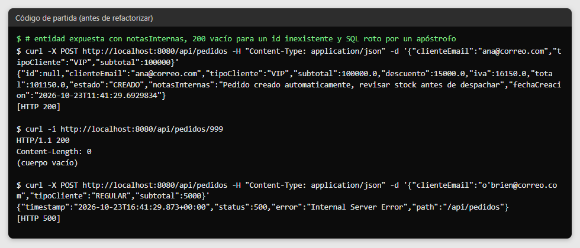
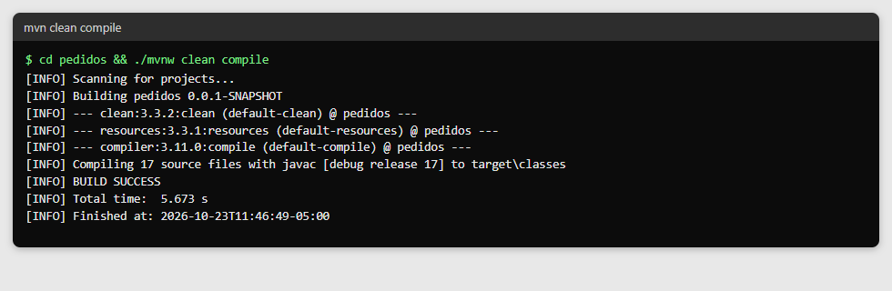
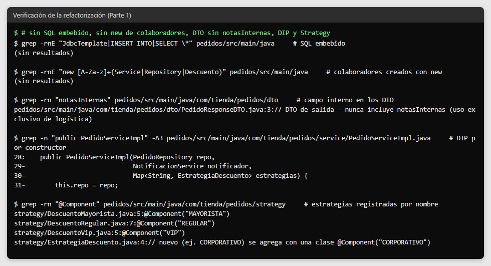
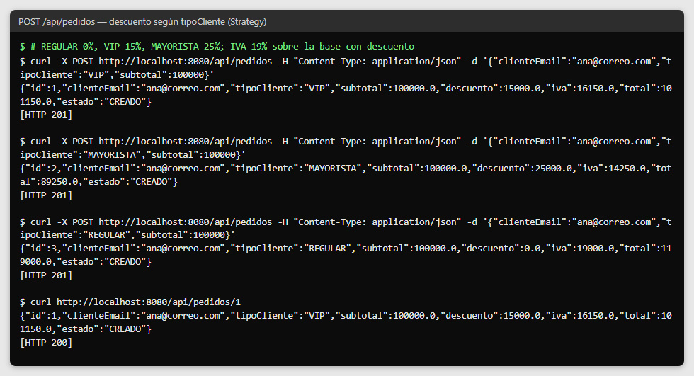
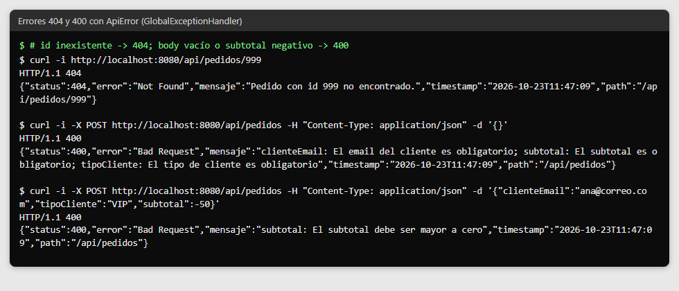
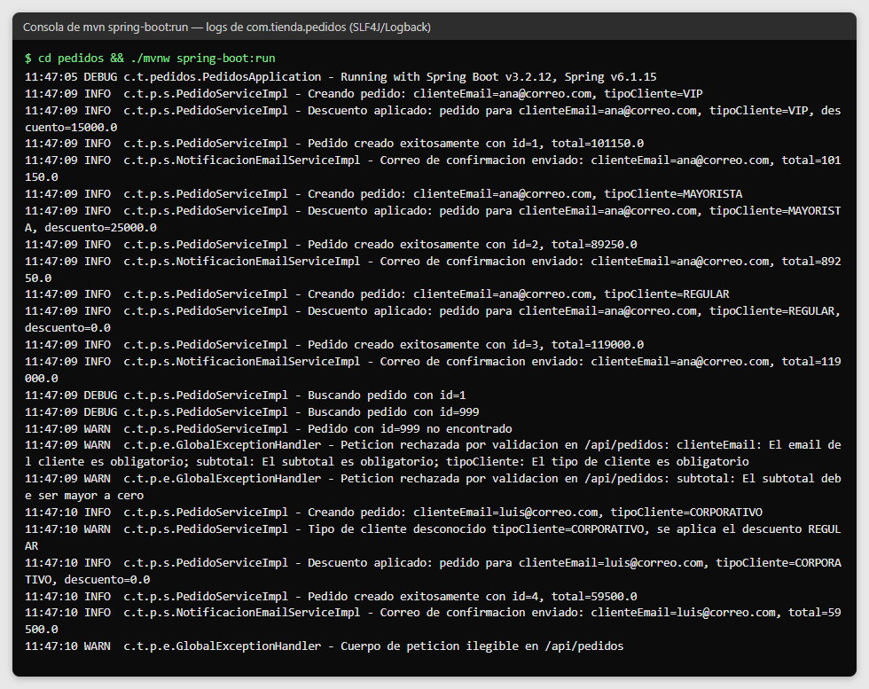
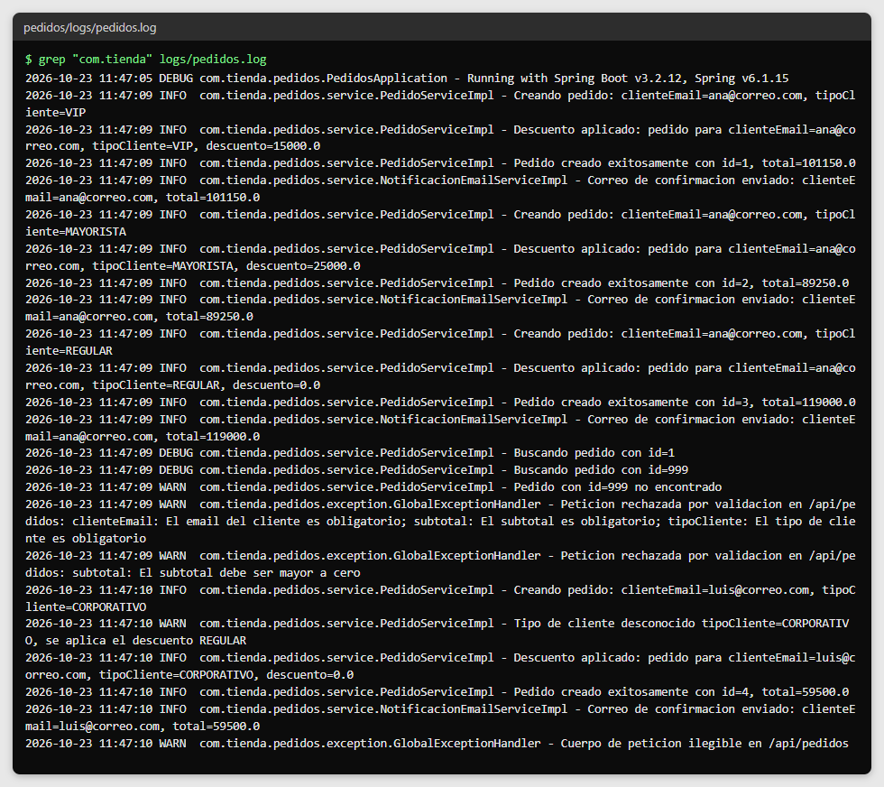
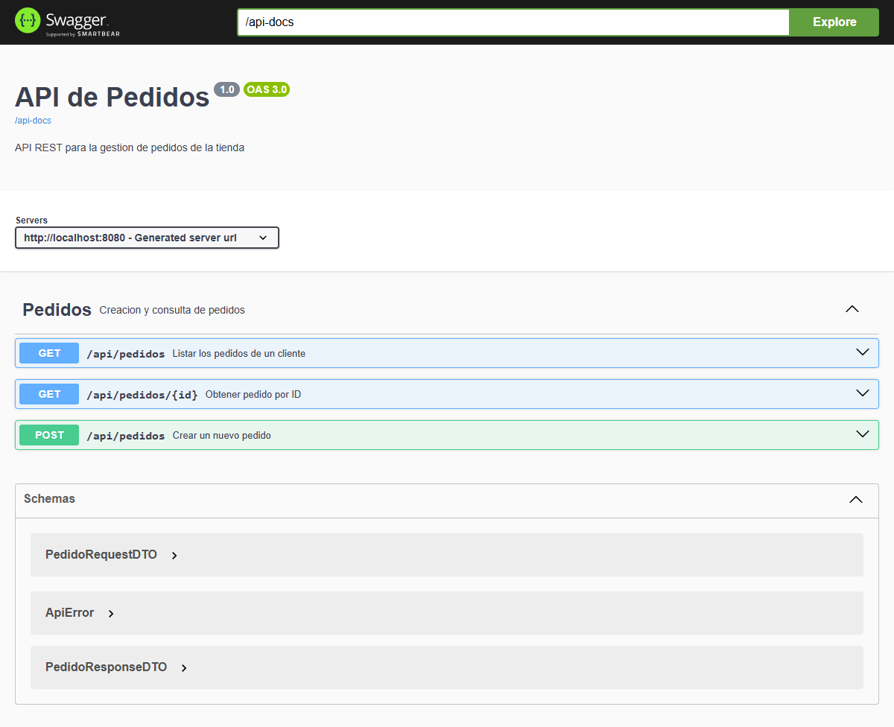
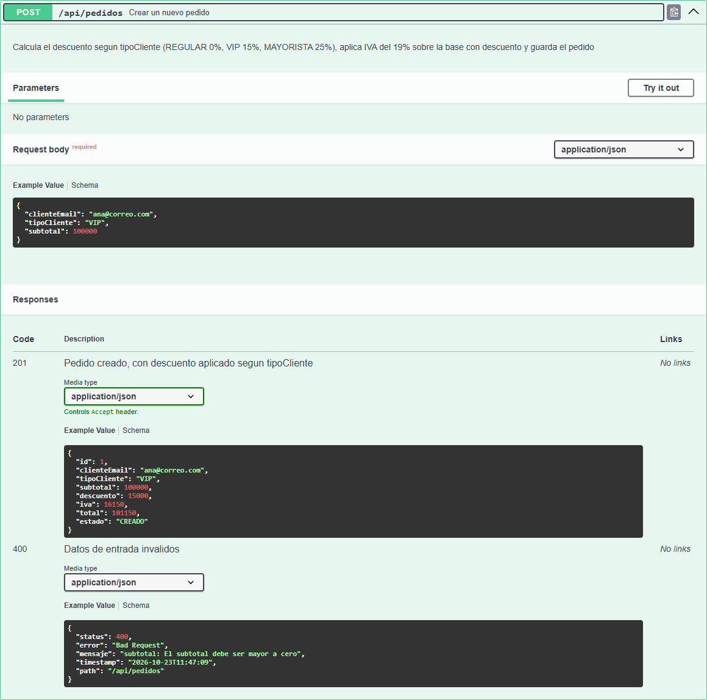
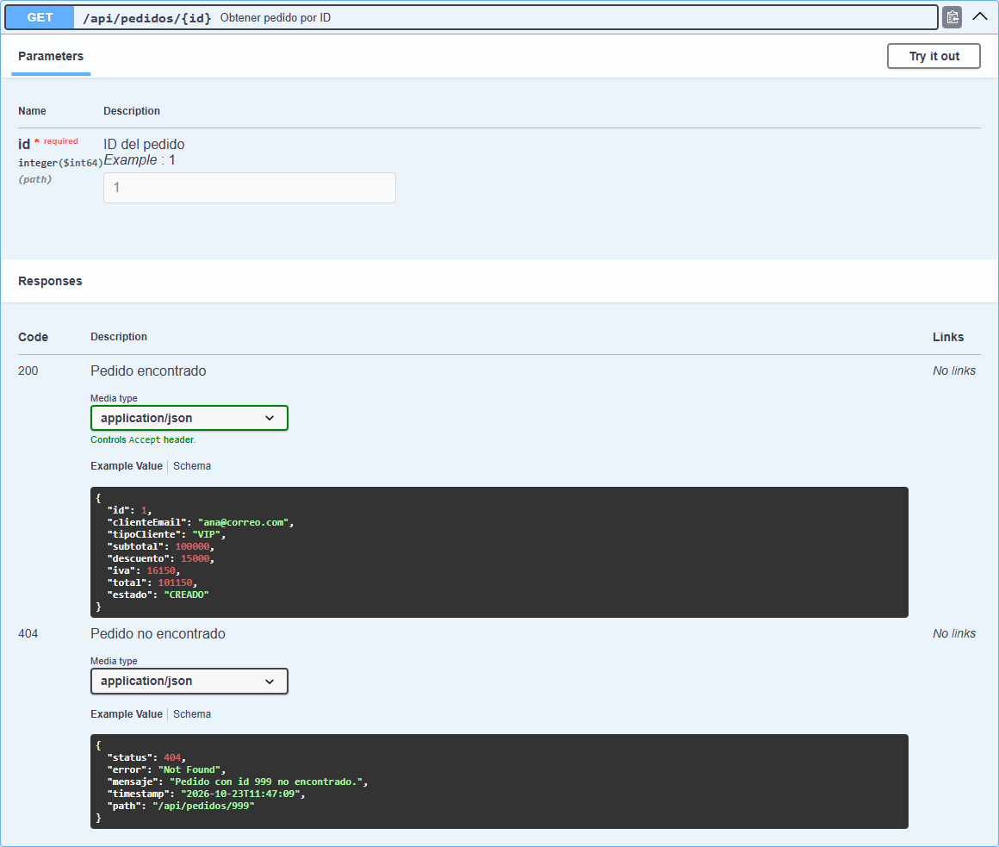

# Post-contenido — Unidad 11: Buenas Prácticas y Patrones de Diseño

## Descripción
Repositorio del laboratorio de la Unidad 11 de Programación Web —
Séptimo Semestre. Contiene un único proyecto Maven Spring Boot
(`pedidos/`) que parte de un código con violaciones reales de SOLID
(SRP y DIP), SQL embebido y una entidad JPA expuesta directamente en
la API, y lo refactoriza aplicando arquitectura en capas, el patrón
DTO, inyección de dependencias por constructor y el patrón Strategy
para el descuento por tipo de cliente. Se extiende con manejo centralizado
de errores (`@RestControllerAdvice`), logging (SLF4J/Logback) y
documentación de la API (springdoc-openapi/Swagger).

**Tecnologías:** Java 17, Spring Boot 3.2.12, Spring Data JPA, H2, Bean Validation, SLF4J/Logback,
springdoc-openapi 2.3.0.

## Endpoints
| Método | Ruta | Respuestas |
|---|---|---|
| POST | `/api/pedidos` | 201 `PedidoResponseDTO` · 400 `ApiError` |
| GET | `/api/pedidos/{id}` | 200 `PedidoResponseDTO` · 404 `ApiError` |
| GET | `/api/pedidos?clienteEmail=` | 200 lista de `PedidoResponseDTO` · 400 `ApiError` si falta el parámetro |

Reglas de cálculo: descuento según `tipoCliente` (REGULAR 0%, VIP 15%, MAYORISTA 25%), IVA del 19%
sobre el subtotal con descuento, total = base con descuento + IVA. Un `tipoCliente` desconocido usa
el descuento REGULAR y se registra un WARN.

## Arquitectura resultante (diagrama de clases)
```
Cliente HTTP (JSON)
   │
   ▼
[controller] PedidoController ─────────── errores ───▶ [exception] GlobalExceptionHandler (@RestControllerAdvice)
   │  recibe PedidoRequestDTO,                                    ├── RecursoNoEncontradoException → 404
   │  devuelve PedidoResponseDTO                                  └── ApiError (cuerpo de error)
   │  depende de la interfaz
   ▼
[service] «interface» PedidoService
   △ implements
   │
[service] PedidoServiceImpl ── toResponseDTO() (mapeo entidad → DTO)
   │   dependencias por constructor (DIP):
   ├──▶ [repository] PedidoRepository  extends JpaRepository<Pedido, Long>
   │                    └── findByClienteEmail(String)
   │                              │
   │                              ▼
   │                      [entity] Pedido (@Entity, incluye notasInternas)
   │
   ├──▶ [service] «interface» NotificacionService
   │                 △ implements
   │                 └── NotificacionEmailServiceImpl
   │
   └──▶ Map<String, EstrategiaDescuento>   (Spring lo llena con el nombre de cada bean)
            [strategy] «interface» EstrategiaDescuento
                         △ implements
                         ├── DescuentoRegular    @Component("REGULAR")    0%
                         ├── DescuentoVip        @Component("VIP")       15%
                         └── DescuentoMayorista  @Component("MAYORISTA") 25%

[dto] PedidoRequestDTO  (entrada: @NotBlank, @NotNull, @Positive, @Schema)
[dto] PedidoResponseDTO (salida: sin notasInternas, @Schema)
```

```
pedidos/src/main/java/com/tienda/pedidos/
├── PedidosApplication.java          (@OpenAPIDefinition)
├── controller/   PedidoController
├── service/      PedidoService, PedidoServiceImpl, NotificacionService, NotificacionEmailServiceImpl
├── repository/   PedidoRepository
├── dto/          PedidoRequestDTO, PedidoResponseDTO
├── entity/       Pedido
├── strategy/     EstrategiaDescuento, DescuentoRegular, DescuentoVip, DescuentoMayorista
└── exception/    ApiError, GlobalExceptionHandler, RecursoNoEncontradoException
pedidos/src/main/resources/
├── application.properties
└── logback-spring.xml
```

## Violaciones del código de partida y cómo se corrigió cada una
El primer commit contiene el código de partida tal como lo entrega la guía, así que el historial
muestra la refactorización paso a paso. Antes de refactorizar se ejecutó y se observó (ver captura
`antes-codigo-partida.png`):

| # | Violación en el código de partida | Evidencia observada | Corrección |
|---|---|---|---|
| 1 | **SRP:** `crearPedido` validaba, calculaba el descuento, armaba el SQL, persistía, notificaba y registraba el log en un solo método | — | Validación en `PedidoRequestDTO` (Bean Validation), cálculo en las estrategias, persistencia en `PedidoRepository`, orquestación en `PedidoServiceImpl`, notificación en `NotificacionService` y log con SLF4J |
| 2 | **DIP:** `new NotificacionEmailService()` dentro del controller | — | Interfaz `NotificacionService` inyectada por constructor; el controller depende de la interfaz `PedidoService` |
| 3 | **SQL embebido y concatenado** en el controller (`JdbcTemplate`) | Un correo con apóstrofo (`o'brien@correo.com`) rompió el `INSERT` → 500 | `PedidoRepository extends JpaRepository`; consultas parametrizadas, sin SQL a mano |
| 4 | **Entidad expuesta:** se devolvía `Pedido` completo | La respuesta incluía `notasInternas` y `"id": null` | `PedidoRequestDTO` y `PedidoResponseDTO` (sin `notasInternas`) con mapeo explícito en `toResponseDTO()` |
| 5 | **Errores silenciados:** `try/catch` con `println` que retornaba `null` | `GET /api/pedidos/999` → 200 con cuerpo vacío | La excepción sube a `GlobalExceptionHandler` → 404 con `ApiError` |
| 6 | **Lógica de descuento con `if/else`** en el controller | — | Patrón Strategy: un tipo nuevo de cliente se agrega con una clase, sin tocar el servicio (OCP) |
| 7 | **Logging con `System.out.println`** | — | SLF4J con placeholders `{}` y niveles DEBUG/INFO/WARN/ERROR; no queda ningún `println` |

## Parte 1 — Refactorización con SOLID, DTO y Strategy
El código de partida tenía un `PedidoController` con SQL embebido, un método `crearPedido` que
violaba SRP (validaba, calculaba, persistía, notificaba y registraba en un solo bloque), una
dependencia de notificación creada con `new`, y devolvía la entidad `Pedido` completa como respuesta
JSON. Se extrajeron `PedidoRepository` (DAO vía `JpaRepository`), `PedidoService`/`PedidoServiceImpl`
(DIP por constructor), `PedidoRequestDTO`/`PedidoResponseDTO` (sin `notasInternas`), y el patrón
Strategy (`EstrategiaDescuento` con implementaciones Regular/Vip/Mayorista) inyectado como
`Map<String, EstrategiaDescuento>`.

Orden de los commits de la Parte 1:
1. Proyecto de partida (código con las violaciones, tal como lo entrega la guía).
2. DTOs y `PedidoRepository`: desaparece el SQL embebido y la entidad deja de salir por la API.
3. `PedidoService` con DIP: el controller solo delega; el `new` del notificador se reemplaza por inyección.
4. Patrón Strategy: el `if/else` del descuento se reemplaza por el mapa de estrategias.

### Decisiones de diseño — Parte 1
- **JpaRepository en vez de mantener JdbcTemplate:** el SQL concatenado abría la puerta a inyección
  SQL (un apóstrofo bastó para romperlo) y obligaba a sincronizar las sentencias con la entidad a mano.
  `PedidoRepository` hereda el CRUD y genera `findByClienteEmail` a partir del nombre del método.
- **Strategy en vez de un segundo patrón creacional para la conversión DTO:** el descuento tiene
  variación real de comportamiento (OCP: un tipo `CORPORATIVO` se agrega con una clase
  `@Component("CORPORATIVO")` sin modificar el servicio); la conversión entidad-DTO es un mapeo 1:1
  resuelto en un método privado `toResponseDTO()`, evitando sobre-ingeniería.
- **`Map<String, EstrategiaDescuento>` inyectado:** Spring registra cada estrategia con el nombre de
  su bean como llave, así el servicio no contiene ningún `switch` ni `if` por tipo de cliente.
- **`@NotNull` además de `@Positive` en `subtotal`:** `@Positive` considera válido un `null`; sin
  `@NotNull`, un body `{}` llegaba al servicio y terminaba en 500.
- **Montos redondeados a 2 decimales** al calcular descuento, IVA y total, para no arrastrar errores
  de punto flotante en valores monetarios.

## Parte 2 — Manejo de Errores, Logging y Documentación
`GlobalExceptionHandler` con `@RestControllerAdvice` reemplaza el try/catch disperso del código de
partida, capturando `RecursoNoEncontradoException` (404), `MethodArgumentNotValidException` (400) y
`Exception` genérica (500). Además responde 400 a un JSON mal formado y respeta el código propio de
las excepciones de Spring MVC (ruta inexistente 404, método no permitido 405, parámetro faltante 400)
en vez de convertirlas en 500. `PedidoServiceImpl` registra sus eventos con SLF4J usando placeholders
y niveles DEBUG/INFO/WARN/ERROR. `logback-spring.xml` configura un appender de consola y un
`RollingFileAppender` con rotación diaria y 30 días de historial en `logs/pedidos.log` (carpeta
excluida en `.gitignore`). La API está documentada con springdoc-openapi (`@OpenAPIDefinition`,
`@Tag`, `@Operation`, `@ApiResponse`, `@Parameter` y `@Schema`), visible en Swagger UI en
`/swagger-ui.html`.

| Nivel | Cuándo se registra |
|---|---|
| DEBUG | Búsqueda de un pedido por id y consulta por cliente |
| INFO | Creación del pedido, descuento aplicado, pedido guardado (con su id) y correo enviado |
| WARN | Pedido no encontrado, `tipoCliente` desconocido (se aplica REGULAR), petición rechazada por validación o JSON ilegible |
| ERROR | Error inesperado (500) y fallo al enviar la confirmación de un pedido ya guardado |

### Decisiones de diseño — Parte 2
- **El registro del descuento aplicado vive en un único punto de `PedidoServiceImpl`**, no en cada
  Strategy, para no dispersar el rastro de auditoría en tres clases distintas.
- **`notasInternas` nunca se registra en los logs ni se expone en el DTO de respuesta**, por ser
  información operativa interna; los logs solo llevan identificadores (id, clienteEmail, tipoCliente)
  y montos. Se verificó que no aparece ni en la consola ni en `logs/pedidos.log`.
- **Un fallo al enviar el correo no anula el pedido:** el pedido ya quedó guardado, así que el
  servicio registra un ERROR con el id para que soporte reenvíe la confirmación.
- **`springdoc.override-with-generic-response=false`:** cada endpoint documenta solo las respuestas
  que realmente devuelve, con un ejemplo de `ApiError` propio para cada código de error.

## Cómo compilar y ejecutar
1. Clonar el repositorio: `git clone https://github.com/Moisex006/cardenas-post1-u11.git`
2. Ejecutar `./mvnw spring-boot:run` dentro de `pedidos/` (H2 en memoria, sin instalar nada más)
3. Probar los endpoints con Postman o curl en http://localhost:8080/api/pedidos, por ejemplo:
   ```bash
   curl -X POST http://localhost:8080/api/pedidos -H "Content-Type: application/json" \
        -d '{"clienteEmail":"ana@correo.com","tipoCliente":"VIP","subtotal":100000}'
   ```
4. Consultar los logs en consola y en `pedidos/logs/pedidos.log`
5. Abrir la documentación interactiva en http://localhost:8080/swagger-ui.html

## Capturas de pantalla
Las capturas de comandos muestran la salida real de `mvn`, `curl` y de los logs de la aplicación.

### Antes de refactorizar
Código de partida en ejecución: entidad con `notasInternas` expuesta, 200 vacío para un id inexistente
y SQL roto por un apóstrofo:



### Parte 1
Compilación exitosa:



Checkpoints 1 y 2 — sin SQL embebido, sin `new` de colaboradores, DTO sin `notasInternas`, DIP por
constructor y estrategias registradas por nombre:



Checkpoint 3 — Strategy con los tres tipos de cliente (VIP, MAYORISTA, REGULAR):



### Parte 2
Respuestas 404 y 400 con `ApiError`:



Logs en consola y en archivo:




Swagger UI con los endpoints documentados, y los endpoints POST y GET por id expandidos:




